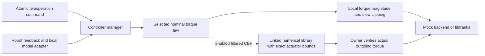

# Package ownership after CBF removal

`teleop_controllers` owns the complete arm runtime: input gates, controller
selection, reference shaping, model adaptation, torque magnitude/rate clipping,
hardware/mock backends and arm telemetry. It uses the `cbf_safety_filter`
numerical library when CBF is enabled. Hardware requires an explicit shadow or
filtered output mode. See the commissioning procedure in the repository documentation.
There is no separate torque node, shared repair or embedded fallback law. The default-disabled safety library can use a native-QP proposal worker; the owner rebuilds and independently verifies current constraints before issuing any command.

The active arm path is:



Every nominal law passes through the same package-local actuator interval:

- lower bound: `max(-torque_limit, tau_J_d - rate * dt)`;
- upper bound: `min(+torque_limit, tau_J_d + rate * dt)`;
- the rate interval uses at most 1 ms per callback;
- invalid/nonfinite state or an empty interval terminates control rather than
  sending a placeholder torque.

Configure `controller.torque_limit_scale` and
`controller.torque_rate_limit_scale`, both in `(0, 1]`. Defaults remain 0.35:
30.45 Nm on joints 1–4, 4.2 Nm on joints 5–7 and 350 Nm/s. Per-arm
`arm_settings.<name>.controller` overrides are applied independently. Absolute
`torque_limits` and `maximum_torque_rate` may tighten these ceilings. Scaling is
applied once inside each arm runtime.

Controller reference shaping, tracking-error protection and Cartesian wrench
caps are optional, independent features. All three default to **false** in the
runtime, standalone controller defaults and single/dual bringup YAMLs:

```yaml
controller:
  reference_shaping_enabled: false
  tracking_protection_enabled: false
  cartesian_wrench_limits_enabled: false
```

With reference shaping disabled, the mapped pose and twist pass directly to the
nominal law; orientation-only mode still holds translation. Enabling shaping
uses the four `reference_*speed`/`reference_*acceleration` settings. Enabling
tracking protection checks measured error against the reference selected for
that cycle (shaped or direct), using `tracking_position_limit` and
`tracking_orientation_limit`. Exceeding a full threshold, or half a threshold
for more than 250 ms, latches braking/holding until restart. With tracking
protection disabled, these errors do not cause that stop. The independent
malformed-input, stale-command and implausible-feedforward gates remain.

`cartesian_wrench_limits_enabled` enables `cartesian_force_limit` and
`cartesian_moment_limit` inside the impedance law. With it disabled, that law
computes its original wrench. These are computed wrench caps, not measured
contact-force limits. Numeric settings remain positive validated values, ready
for use when enabled. Per-arm overrides support the same three switches.
The switches are read at startup; restart the launch after changing them.
Actuator magnitude and slew-rate clipping always follows the nominal law.

Home-pose validation, homing trajectory speed settings, nullspace posture
preferences, Cartesian reference shaping and tracking-response settings remain
controller functions. They do not establish joint-state constraint enforcement.
The recent model-residual monitor, hard joint-speed trip and nominal joint
acceleration limiter were removed with the abandoned safety integration.

## Optional numerical CBF library

The separate `cbf_safety_filter` package provides a ROS-independent synchronous filter. It receives coherent model data, nominal torque and actuator bounds. The controller owner remains responsible for issuing commands and handling rejected results. The single and dual profiles enable the library through their package YAML paths.

The filter has one hard-row QP formulation with seven torque variables and no slack variables. Every enabled constraint uses the same bounded-recovery behavior: when a requested row set is infeasible, torque bounds may be widened only to include a clipped braking anchor, and the resulting command is independently verified. The policy formerly called `snapshot_recovery` is named **bounded recovery** because its permitted constraint relaxation is limited by that braking anchor. `safety_torque_computation_method` selects projection or a native QP for recovery; `fallback_strategy` is fixed to `bounded_recovery`.

Inter-arm collision checking uses one supported policy: `independent`. Each arm checks its current model against the latest valid peer snapshot, subject to the configured age and timestamp-skew limits. CBF diagnostics report status, hard-row residuals and timing. Invalid models, failed solves, failed verification and deadline overruns follow the configured protective handling path.

## Bringup owns orchestration

All launch entry points are in `teleop_bringup`:

- `teleoperation.launch.py`: combined pipeline from an explicit runtime YAML;
- `cartesian_pd_controller.launch.py`: arm owners;
- `homing.launch.py`: arm owners with homing available;
- `gripper.launch.py`: Hand workers;
- `quest_teleop.launch.py`: Quest bridge, mappers and optional mock feedback;
- `quest_usb_bridge.launch.py` and `pose_mapper.launch.py`: individual input nodes;
- `recording.launch.py`: recording;
- `robot_free.launch.py`: mapping and optional recording without arm owners.

The arm-routing defaults are `teleop_bringup/config/single_panda/arms.yaml` and
`arms_two_mock.yaml`. Feature defaults remain in their owning packages:
`teleop_controllers/config/standalone.yaml`,
`teleop_gripper/config/standalone.yaml` and `recording/config/standalone.yaml`.
The combined single/dual YAMLs remain in `teleop_bringup/config/`.

Only bringup imports cross-package configuration or launches other project
executables. Feature runtimes own their utilities and do not import/link one
another. Shared ROS messages in `quest_teleop_interfaces` and external libraries
such as ROS, Eigen and libfranka remain explicit dependencies.

## Diagnostics and verification

Controller telemetry contains nominal, locally clipped, robot-desired and
measured torque stages. The new optional `cbf_status` JSON topic reports filter status, each relaxation,
residuals and numerical timings through a bounded queue and non-RT publisher.
Existing TrackingSample fields remain unchanged by the new layer. Rebuild all message
consumers after the `TrackingSample` schema change; use the matching historical
software version to deserialize older TrackingSample bags.

Recorded numerical model snapshots are historical evidence under
`docs/incidents/2026-10-29/models/`. The package-local snapshot reader accepts the
old `CBF_MODEL_V1` marker; new files use `ROBOT_MODEL_V1`. This compatibility reader
contains no CBF computation or execution policy.

Robot-free tests verify package dependencies, local clipping in independently
configured mock arms, input/reference/hold/homing behavior, Hand behavior,
centralized launch, recording and export. No hardware operation is part of these
checks. Removing CBF does not establish physical tracking or stopping safety.


In commissioning shadow mode, the owner computes CBF proposals but issues only
the selected nominal controller's locally clipped torque. It does not install CBF
reference projection or compute a CBF holding command. Rejection is diagnostic;
the owner callback deadline and existing nominal/input checks remain active.
`cbf.enabled` and `cbf.hardware_mode` select activation and output mode at
startup. Hardware CBF requires residual and timing diagnostics
and a callback budget of at most 800 µs.

The analytical optimum check first projects the raw nominal law into the current
actuator interval. With diagonal positive weights, this is the exact box optimum;
if all current original rows also hold, native QP work is unnecessary. A fresh
same-epoch worker proposal may likewise be projected into the current interval
before full original-row verification. This does not bypass age/epoch, domain,
actuator or callback checks. Shadow and filtered use the same epoch transitions.
Independent nominal-feasibility diagnostics do not confer command authority.
