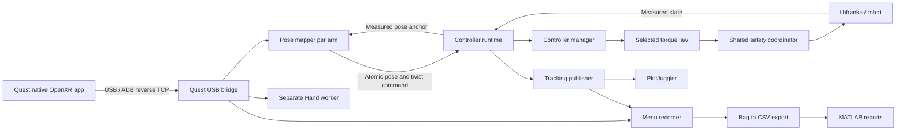

# Teleoperation architecture

The Quest app measures hand motion; ROS maps it into a robot reference; an arm
owner computes seven joint torques and sends them through the safety layer to
libfranka. The Hand and recorder run in separate processes.



## Package responsibilities

| Package | Responsibility | Main launch / config |
| --- | --- | --- |
| `quest_teleop_interfaces` | Shared messages and calibration service | `msg/`, `srv/` |
| `quest_teleop` | C++ USB bridge; Python mapping and configuration validation | `quest_teleop.launch.py`, `config/arms.yaml` |
| `teleop_controllers` | Arm ownership, mode arbitration and joint torque laws | `cartesian_impedance_controller.launch.py`, `config/controllers.yaml` |
| `safety_filter` | Actuator bounds, CBF geometry/QP and coupled coordinator | `safety_filter.launch.py`, `config/safety.yaml` |
| `teleop_gripper` | Hand input decisions and blocking gripper operations | `gripper.launch.py`, `config/gripper.yaml` |
| `recording` | Menu/continuous rosbag recording and tracking CSV export | `recording.launch.py`, `config/recording.yaml` |
| `teleop_bringup` | Composes features using one complete runtime YAML | `teleoperation.launch.py`, `config/single_panda.yaml` or `dual_panda.yaml` |

Legacy `panda_bringup` and `panda_demos` are separate reference packages. Pinned
third-party libraries live in `src/third_party`; do not format or refactor them
as part of changes to the active teleoperation code.

## Arm runtime and controller structure

Safety defaults to asynchronous single/dual operation. `safety_filter` contains
`async_safety.cpp` (per-owner model/result validation and braking/holding),
`realtime_guard.cpp` (bounded current-state constraint verification/repair),
`safety_coordinator.cpp` (latest-only coupled worker) and the underlying
`cbf_safety_filter.cpp` OSQP worker law. The world-table and actuator guards
remain active with the optional CBF disabled. See [CBF_PANDA.md](CBF_PANDA.md).


| File in `teleop_controllers` | Owns |
| --- | --- |
| `src/controller_runtime.cpp` | ROS parameters/subscriptions, command handoff, backend adapters, permanent FCI ownership, shared safety and non-realtime telemetry |
| `src/controller_manager.cpp` | Freshness/session/order gates, arming, state validation, reference capture and selection of one nominal torque law |
| `include/teleop_controllers/torque_controller.hpp` | Common fixed-size state/reference to seven-joint nominal torque interface |
| `src/cartesian_impedance_controller.cpp` | Cartesian impedance with dynamically consistent home-posture/joint-limit nullspace torque |
| `src/position_hold_controller.cpp` | Joint PD holding with stiffness ramp |
| `src/damping_controller.cpp` | Cartesian damping plus Coriolis for safety fallback and shutdown |
| `src/homing_controller.cpp` | Guarded home gesture, trajectory/controlled-stop state and joint torque law |
| `src/joint_motion_generator.cpp` | Synchronized homing joint references |
| `include/teleop_controllers/control_types.hpp` | Transport-neutral commands, state and statuses |
| `include/teleop_controllers/tracking.hpp` | Fixed-size monitoring snapshots |

The executable retains the name `cartesian_impedance_controller`; it contains
the whole runtime, not just the Cartesian equation. Each arm has one permanent
libfranka owner. Homing and position holding select another law inside that
owner and do not open another arm connection.

Per arm, the ROS input executor also publishes a small latest-pose snapshot at
up to 100 Hz using best-effort, depth-one QoS. The mapper subscribes with that
QoS. Bulk status publication has a separate executor, and full-cycle tracking
has a separate publisher thread. A slow status publish therefore cannot block
Quest callbacks or the pose anchors needed for engagement. All handoffs from
the torque thread remain fixed-size and nonblocking; monitoring does not change
the 100 ms command/pose freshness gates.

The manager chooses homing while active, Cartesian control while engaged,
joint holding at startup/normal trigger release, or damping for safety fallback
and shutdown.
Hold entry captures all seven measured joints once; subsequent release samples
do not move the target. Startup and paused holding are independent of Quest
readiness. Ordinary input faults preserve a parked anchor; faults during engaged
teleoperation capture measured joints once and select local holding. Arming is
revoked until fresh release/re-engagement. Safety fallback and shutdown still
exit holding; homing keeps priority.
`motion_enabled=false` means Quest teleoperation is disengaged; joint holding
can still produce restoring torque. Re-engagement captures fresh mapping
anchors. See [runtime behavior](TELEOPERATION_RUNTIME.md).

The Cartesian law uses measured pose error `e`, measured Jacobian `J` and mapped
reference twist `v_ref`:

```text
r = J*dq - v_ref + lambda .* e
tau_nominal = -transpose(J) * (gain .* r) + coriolis
```

`.*` denotes componentwise Cartesian multiplication before the Jacobian
transpose maps the wrench to joints. Gains are fixed at startup. Gravity follows
libfranka's torque-interface convention; the law adds no extra gravity term.

### Damping and nullspace behavior during engagement

Expanding the law gives `tau = Jᵀ[-K e - D(J dq - v_ref)] + coriolis`, with
`D = diag(gain)` and `K = diag(gain .* lambda)`. Consequently, increasing
`gain_translation` increases both translational damping and stiffness.
To change damping at fixed stiffness, change the corresponding lambda so that
`gain * lambda` stays fixed. These coefficients do not define one universal
damping ratio: task inertia changes with arm configuration and payload, and
the current law does not shape inertia or adapt damping to it.

There is no explicit nullspace damping, posture reference, projected joint PD
term or joint-limit avoidance objective in the engaged Cartesian law.
For a joint velocity with `J dq = 0`, its Cartesian damping term is zero.
The optional dynamically consistent nullspace term adds home-posture and
joint damping in this redundant direction. The Cartesian damping term alone
does not suppress it. Joint position holding and its
`hold_damping` gains apply when the manager selects holding; they are not
added to Cartesian control while the trigger is held. The separate
`damping_controller.cpp` is a fallback/shutdown law, not another damping term
running in parallel with the engaged controller.

Pose/velocity filtering and interpolation are implemented in the mapper and
are independent. A filtered reference twist is not necessarily the derivative
of the published reference pose. Delayed twist after a stop, reference steps,
insufficient task damping and actuator clipping are separate possible causes
of overshoot. A fixed accurate Cartesian pose with a swinging elbow instead
points toward redundant joint motion. Use measured/reference pose and twist,
joint velocities and torque-limit flags to distinguish these effects before
changing gains. `feedforward_scale` currently blends native and pose-derived
velocity estimates; zero selects the pose-derived estimate and does not turn
off reference velocity feedforward.

All laws return nominal torque before safety intervention. The default runtime
publishes a latest-only worker snapshot and performs current-state local
verification/repair without waiting. A usable worker correction is added to the
current nominal torque, never substituted blindly for a new target. Model source
age, context epochs and source-state change bounds gate reuse. Trigger release,
session/reference changes, homing and shutdown invalidate old contexts.

Magnitude/rate bounds remain anchored to current `tau_J_d`; configured scales
default to 0.35 and stricter controller caps still apply. A world-table guard
protects modeled links and Hand even with the optional CBF disabled. Dual owners
receive independent peer snapshots, while the worker solves the coupled problem.
Local inter-arm rows include bounded peer torque and displacement uncertainty.
Missing/stale worker or peer information causes braking/holding instead of a
callback wait. Recovery needs a fresh post-fault release/re-engagement and healthy
results. Shared exceptional stop and normal finishing coordination remain.
The original synchronous mode is retained explicitly for comparison; see
[CBF_PANDA.md](CBF_PANDA.md).

## Add another controller design

Implement `TorqueController` in a separate source/header. Its `compute()` takes
`ArmState`, a typed `CartesianReference` or `JointReference`, and the callback
period, and returns `NominalTorque` with seven torques and a fault status.
Use `reset()` to initialize controller state from measured state. Neither
method may allocate, block, perform I/O or call ROS in realtime.

Construct the design in the runtime before control starts and inject it into
`ControllerManager` in place of the baseline Cartesian law. Register its source
in CMake and add parameter validation and focused tests. A new command type
also needs a validated reference adapter. Ownership, homing arbitration, release
holding, fault behavior, safety and monitoring remain shared. Dynamic plugin
loading and live design switching are not implemented.

## Hand, monitoring and recording

The Hand worker owns only the gripper connection. `hand_core.cpp` maps a
normalized inward joystick axis to fixed-speed closing or opening, with a
neutral gate after calibration/input faults. `hand_worker.cpp` runs blocking
force grasps, opening moves, readback and independent cancellation. Mirrored
horizontal directions are normalized per assigned hand. Neutral stops unfinished
motion while a completed, validated cable grasp remains force-held. An outward
command releases that hold before opening. Quest loss preserves the confirmed
hold but cancels unfinished motion and requires fresh neutral before movement.

Grasps require configured force plus a cable diameter/tolerance band. Firmware
success and `is_grasped` readback must agree with the band; empty closure is
rejected. There are no automatic force increases or closing retries. Motion
and cancellation remain serialized. Completed-command gating prevents neutral
from releasing a just-completed grasp during final readback. The worker checks
completions every 1 ms by default, and status/log I/O stays outside the input
path. Pose tracking is independent of joystick availability. Enabling Hand still
requests one empty-hand startup calibration; explicit recovery remains available.
See [Hand control](TELEOPERATION_RUNTIME.md#hand-joystick-control-and-force-holding).

Calibration and live-close feedback share a bounded 10 micrometre endpoint
readback allowance. Accepted internal widths are clamped to calibrated travel;
commands never gain extra travel. Result logs preserve raw width and maximum
width, and a rejected completion emits an error immediately. Larger/invalid
readback or communication faults still revoke calibration. Desk's disconnected
Hand indicator during FCI control is not itself a worker communication failure.

The torque thread copies fixed-size snapshots to a bounded queue. A dedicated
non-realtime thread publishes full-cycle `tracking_samples`; `tracking_status`
provides the latest live view at up to 100 Hz. Overflow drops monitoring samples
with a counter. PlotJuggler consumes the live view; the recorder captures the
full stream; `recording export_tracking` creates CSVs for MATLAB. Clock, validity
and torque conventions are in [trajectory monitoring](TRAJECTORY_MONITORING.md).

## Configuration and launch entry points

Combined bringup accepts exactly `runtime_config` (required path) and
`operator_confirm` (default false, required true for hardware). Everything else
comes from the selected runtime YAML. Package-local configs apply only to
standalone launches. Inspect the backend before launching an edited file.

Standalone feature launches include `quest_usb_bridge.launch.py`,
`pose_mapper.launch.py`, `homing.launch.py`, `gripper.launch.py` and
`recording.launch.py`. `safety_filter.launch.py` includes parameters for the arm
owner; it does not start an independent robot process.
`teleop_bringup robot_free.launch.py` starts mapping and optional recording
without an arm or Hand owner. It has its own launch arguments and supports an
explicit synthetic measured-pose publisher. Never run that publisher beside
an arm owner on the same measured-pose topic.

Use the [main README](../README.md) for setup/launch, the
[development guide](DEVELOPMENT.md) for builds/tests and the
[implementation record](IMPLEMENTATION_PROGRESS.md) for verification limits.
