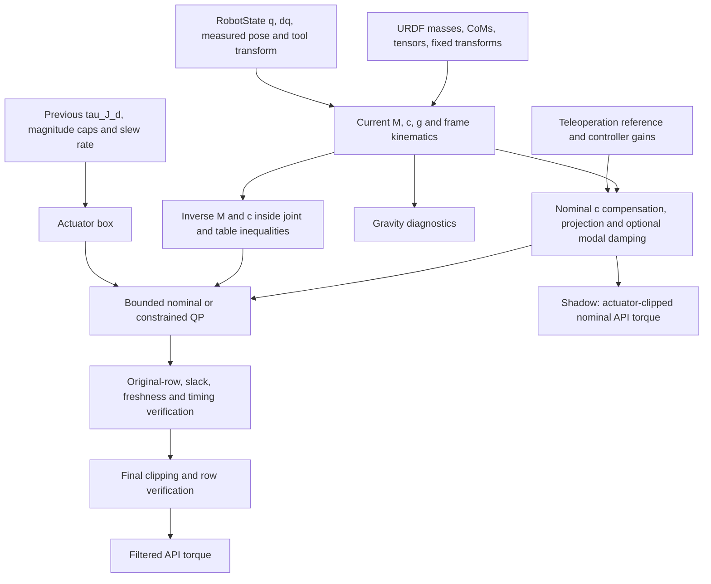

# Why the OSCBF URDF changes feasibility, and what that establishes

Date: 2026-11-08. This report evaluates the currently implemented model replacement and the recorded evidence. No controller, CBF, geometry or launch settings were changed for this report, and no robot was contacted. OSCBF references are pinned to commit `6082329f8e1d61ee8e875a63a5cd80a14d513e12`.

**2026-11-09 update:** the subsequently confirmed 5 g UMI attachments are now
included in an augmented URDF and active swept collision cover. The missing-finger
statements below describe the November 8 state; see the
[new integration and avoidance replay report](UMI_FINGERS_AND_OFFLINE_AVOIDANCE.md).
The inherited inertia-calibration limitations remain.

## 1. Answer and hardware status

**The numerical cause of the replay improvement is established: replacing the mass matrix changes the torque-to-acceleration map inside the constraints. At the recorded states, those changed constraints admit the existing actuator-bounded commands. The evidence does not establish that the new matrix is an identified physical or effective inertia of this robot.**

The implementation and offline/mock checks support the next **single-arm shadow commissioning** stage, following a small-motion baseline check with the new runtime and generous free-space clearance. In shadow, `cbf.enabled: true` runs the calculations, but the robot receives the actuator-clipped nominal command. Shadow supplies no CBF protection. The new model changes parts of nominal control even with CBF disabled, so previous baseline trials do not fully qualify this runtime.

The evidence does **not** yet justify treating filtered-torque operation as qualified table/joint protection. In particular:

- The exact URDF inertias lack a demonstrated physical calibration or a conservative command-to-acceleration error bound.
- The printed finger's mounted envelope and opening sweep are not yet included in the active table capsules. Adding its STL as a visual would not fix that route.
- Acceptance of free-space commands does not exercise the filter's physical intervention or braking near a boundary.

The current single-arm YAML still has CBF disabled and selects shadow if explicitly enabled. The dual-arm YAML still has CBF disabled and hardware mode blocked; dual hardware CBF is deliberately rejected. This report changes neither setting. The staged procedure remains [HARDWARE_COMMISSIONING.md](HARDWARE_COMMISSIONING.md).

## 2. URDF versus libfranka: representation, parameters and equations

URDF is a way to supply a link tree and its parameters. It does not inherently yield a better dynamics equation. Given identical inertial parameters, joint transforms, attachment configuration and coordinate conventions, compatible rigid-body algorithms should produce the same joint mass matrix whether the inputs came from a URDF or a manufacturer library.

The replacement therefore changes **the supplied robot model and its provider**, not a mathematical rule that is special to XML.

The runtime does not infer mass or inertia from visual meshes. Those values come
from explicit inertial tags, independently of how realistic the displayed mesh
looks. The table filter in turn uses its separately configured collision
capsules. A visual mesh, an inertial model and a collision envelope have distinct
roles.

### Previous provider

The workspace's libfranka 0.9.2 `Model::mass(state)` evaluates a downloaded manufacturer model using the current joint positions and the state's configured attachment mass, inertia and centre of mass. Its Coriolis and gravity calls are separate evaluations. Runtime evaluation is not online identification: the wrapper does not estimate new inertial parameters from each measured torque/acceleration pair. The complete link coefficients inside the downloaded library are not exposed by that wrapper. Consequently, we can compare its captured numerical matrices, but cannot honestly provide a complete coefficient-by-coefficient manufacturer-versus-URDF table from this repository. [Version-matched mass wrapper](https://github.com/frankarobotics/libfranka/blob/0.9.2/src/model.cpp#L189-L219), [downloaded model library](https://github.com/frankarobotics/libfranka/blob/0.9.2/src/model_library.cpp#L9-L34).

### Current provider

The native C++ `UrdfPandaModel` reads the exact pinned OSCBF Panda asset before control starts. It evaluates that fixed parameter set at each current `q,dq`; no JAX/Python or file access is required in a callback. Both nominal control and CBF consume the same current mass matrix and Coriolis vector. The calculations agree with execution of the original OSCBF functions to floating-point precision. [Native provider](../../src/teleop_controllers/src/urdf_model.cpp), [integration](../../src/teleop_controllers/include/teleop_controllers/franka_model.hpp), [implementation and verification](../URDF_DYNAMICS.md).

For body \(i\), let \(m_i\) be its mass, \(r_{C,i}\) its local centre of mass, \(I_{C,i}\) its rotational inertia about that centre, and \(R_i(q)\) its orientation in the base frame. The centre-of-mass and angular Jacobians give

\[
v_{C,i}=J_{v,i}(q)\dot q,\qquad
\omega_i=J_{\omega,i}(q)\dot q.
\]

Summing body kinetic energies,

\[
T=\frac12\sum_i\left(m_i\|v_{C,i}\|^2+
\omega_i^T R_i I_{C,i}R_i^T\omega_i\right)
=\frac12\dot q^T M(q)\dot q,
\]

hence

\[
\boxed{M(q)=\sum_i\left(m_iJ_{v,i}^TJ_{v,i}
+J_{\omega,i}^TR_iI_{C,i}R_i^TJ_{\omega,i}\right).}
\tag{1}
\]

This is the energy construction used by OSCBF. **Diagonal per-body tensors do not imply a diagonal joint mass matrix**: a moving body's Jacobian contains several upstream joint columns, producing off-diagonal coupling. [OSCBF energy implementation](https://github.com/StanfordASL/oscbf/blob/6082329f8e1d61ee8e875a63a5cd80a14d513e12/oscbf/core/manipulator.py#L767-L794).

The corresponding Coriolis/centrifugal *vector* is

\[
c_i(q,\dot q)=\sum_{j,k}\frac12
\left(\frac{\partial M_{ij}}{\partial q_k}
+\frac{\partial M_{ik}}{\partial q_j}
-\frac{\partial M_{jk}}{\partial q_i}\right)\dot q_j\dot q_k.
\tag{2}
\]

OSCBF obtains it by automatic differentiation. Our native implementation computes the equivalent generalized inertial wrench at zero joint acceleration, avoiding numerical differentiation across samples. Thus its calculation method differs, while its evaluated result matches. Here \(c\) already includes the velocity products; it is not multiplied by \(\dot q\) again. Gravity is the potential-energy gradient, equivalently \(-\sum_i J_{v,i}^T m_i g_{\rm world}\). [OSCBF bias implementation](https://github.com/StanfordASL/oscbf/blob/6082329f8e1d61ee8e875a63a5cd80a14d513e12/oscbf/core/manipulator.py#L796-L839).

### The command coordinate remains the same

Write \(u\) for the API's user torque, rather than total physical torque. Under ideal internal compensation the filter uses

\[
\boxed{\hat a=\hat M(q)^{-1}\bigl(u-\hat c(q,\dot q)\bigr).}
\tag{3}
\]

Franka's external-controller documentation describes user torque plus internal gravity/friction compensation; the API describes `tau_J_d` as desired link-side torque without gravity. Thus adding gravity to the right-hand side of (3) merely because gravity exists physically would mix torque coordinates. Compensation/tracking errors can remain in the real system; the convention does not make them zero. This convention and the hardware's internal compensation were unchanged by the provider replacement. [Official controller description](https://frankarobotics.github.io/docs/doc/libfranka/docs/overview.html#external-controller), [version-matched state definitions](https://github.com/frankarobotics/libfranka/blob/0.9.2/include/franka/robot_state.h#L211-L221).

## 3. What is special about the supplied inertia values?

The OSCBF asset README attributes its Panda URDF to `pybullet_robots`; its listed edits concern asset/parser compatibility and fixed gripper joints. It does not document inertia calibration. Following the upstream history finds a 2019 change describing estimated masses/centres of mass and supplying repeated `0.1` diagonal rotational tensors. A later simulation-benchmark change adds zero-mass fixed bodies that also have `0.1` diagonal tensors. The inspected sources give no parameter-fit experiment, residual statistics or uncertainty bound for those tensors. This is a bounded public-source finding, not a claim about unpublished work. [Asset attribution](https://github.com/StanfordASL/oscbf/blob/6082329f8e1d61ee8e875a63a5cd80a14d513e12/oscbf/assets/franka_panda/README.md), [estimated-parameter commit](https://github.com/erwincoumans/pybullet_robots/commit/4ba7af21e69a76d96785f825fd063cd816c8312f), [fixed-body additions](https://github.com/erwincoumans/pybullet_robots/commit/abbad2e5922b6e3693f2624ded9f9211797e925c).

### Exact contribution to joint 7

The following bodies all rotate when joint 7 rotates. Every listed rotational tensor is \(0.1I_3\;\mathrm{kg\,m^2}\).

| Body | Supplied mass, kg | Contribution of rotational tensor to \(M_{77}\), kg m² |
| --- | ---: | ---: |
| `panda_link7` | 0.20 | 0.10 |
| `panda_link8` | 0 | 0.10 |
| `panda_hand` | 0.81 | 0.10 |
| `panda_leftfinger` | 0.10 | 0.10 |
| `panda_rightfinger` | 0.10 | 0.10 |
| `panda_grasptarget` | 0 | 0.10 |

Each finger's centre of mass is 0.01 m from joint 7's axis. The other listed centres lie on that axis. Equation (1) therefore gives, directly from this asset,

\[
\boxed{M_{77}=6(0.1)+2(0.1)(0.01)^2
=0.60002\;\mathrm{kg\,m^2}.}
\tag{4}
\]

Two zero-mass bodies alone contribute \(0.2\;\mathrm{kg\,m^2}\), approximately one third of this value. OSCBF retains their tensors when merging fixed bodies; our exact reproduction does too. This is not a mysterious regularization added by our C++ code. [Pinned distal-body data](https://github.com/StanfordASL/oscbf/blob/6082329f8e1d61ee8e875a63a5cd80a14d513e12/oscbf/assets/franka_panda/panda.urdf#L191-L337), [fixed-body merge](https://github.com/StanfordASL/oscbf/blob/6082329f8e1d61ee8e875a63a5cd80a14d513e12/oscbf/utils/urdf_parser.py#L557-L601).

A physical interpretation requires care. For nonnegative mass density,

\[
I_C=\int\bigl(\|r\|^2I_3-rr^T\bigr)\,dm.
\]

A zero-mass finite body cannot literally have positive inertia under this definition. These entries can be part of a mathematical surrogate, but interpreting them as *identified effective actuator inertia* requires additional evidence. Neither their names nor their mere presence in a working simulation supplies that evidence. Deleting them would change the exact OSCBF model substantially; retaining them faithfully does not itself establish physical accuracy.

### Actual matrices at the captured example

At cycle 22,810, the matrix diagonal changes as follows. Units are kg m².

| Joint | Captured libfranka \(M_{jj}\) | OSCBF URDF \(M_{jj}\) |
| --- | ---: | ---: |
| 1 | 1.167923 | 2.139425 |
| 2 | 2.275773 | 2.995928 |
| 3 | 1.403545 | 2.152473 |
| 4 | 1.000567 | 1.708566 |
| 5 | 0.014057 | 0.816509 |
| 6 | 0.044924 | 0.737109 |
| 7 | 0.002962 | 0.600020 |

Joint 7's diagonal is about 203 times larger. However, acceleration depends on the **whole inverse**, not on \(1/M_{77}\) alone. The seventh inverse row changes from approximately

\[
[9.9990,\;1.6955,\;-5.1220,\;11.0682,\;-147.5394,\;-42.5627,\;513.0045]
\]

to

\[
[0.5436,\;-0.0560,\;0.1507,\;-0.01885,\;-0.7015,\;-0.02207,\;2.6383].
\]

The scalar response inertia \(1/(M^{-1})_{77}\), relevant when other generalized torques are fixed, changes from 0.0019493 to 0.379035 kg m². Coupling explains why the diagonal ratio is not exactly the acceleration ratio.

Both matrices are positive definite. Their smallest eigenvalues here are 0.00175959 and 0.119898; their spectral condition numbers are approximately 1666.85 and 38.26. Better conditioning reduces sensitivity, but is **not** proof that the older infeasibility was a numerical solver failure: the explicit interval proof below establishes a real incompatibility within that older model. All example values are independently recomputed in [example-derived.json](../../log/commissioning/2026-11-08-model-explanation/example-derived.json).

## 4. How the model enters every relevant constraint

### Actuator interval

The actuator limits do not depend on the selected inertia. With previous desired torque \(u_{\rm prev}\), magnitude caps \(T_j\), slew rate \(r\), and callback period \(\Delta t\),

\[
\delta=r\min(\Delta t,0.001),\qquad
\ell_j=\max(-T_j,u_{{\rm prev},j}-\delta),\quad
b_j=\min(T_j,u_{{\rm prev},j}+\delta).
\tag{5}
\]

Under the current launch values, \(T=[30.45,30.45,30.45,30.45,4.2,4.2,4.2]\) Nm and \(r=350\) Nm/s. At 1 ms, each torque can move at most 0.35 Nm from `tau_J_d`. The controller's actuator-clipped nominal is \(u_b=\operatorname{clip}(u_{\rm nom},\ell,b)\). These clipping rules apply with CBF off, in shadow and in filtered mode. [Actuator ownership](../CONTROLLER_ARCHITECTURE.md).

### Joint velocity

For an upper safe speed \(v_s\), define \(h=v_s-\dot q_j\). The first-order velocity barrier requires

\[
\dot h+\alpha h\ge0
\quad\Longleftrightarrow\quad
\hat a_j\le\alpha(v_s-\dot q_j).
\]

Substituting (3), with \(e_j\) a coordinate unit vector,

\[
\boxed{e_j^T\hat M^{-1}u
\le\alpha(v_s-\dot q_j)+e_j^T\hat M^{-1}\hat c.}
\tag{6}
\]

Changing \(M\) changes the row's coefficients and its bias. It changes which torques are deemed admissible even if the measured velocity, margin and alpha are identical. The lower-speed row similarly requires \(\hat a_j\ge-\alpha(v_s+\dot q_j)\). The current margin is 0.1 rad/s and alpha is 10 s⁻¹.

### Joint position

For the upper boundary \(h=q_{s,\max}-q_j\), the second-order barrier is

\[
\ddot h+(\alpha_1+\alpha_2)\dot h+\alpha_1\alpha_2h\ge0.
\]

Since \(\dot h=-\dot q_j\), this requires

\[
\boxed{\hat a_j\le-(\alpha_1+\alpha_2)\dot q_j+
\alpha_1\alpha_2(q_{s,\max}-q_j).}
\tag{7}
\]

For the lower boundary, \(h=q_j-q_{s,\min}\),

\[
\hat a_j\ge-(\alpha_1+\alpha_2)\dot q_j-\alpha_1\alpha_2h.
\]

The implementation also checks the applicable barrier domain, including \(h\ge0\) and \(\dot h+\alpha_1h\ge0\), within its tolerances. Position margins are 0.1 rad; both alphas are 10 s⁻¹. These rows constrain acceleration **before** position reaches a limit. Being visually away from a joint limit is insufficient to prove row feasibility.

### Table avoidance

For a capsule endpoint at world height \(z(q)\), capsule radius \(r_c\), table height \(z_t\) and separate clearance \(d\),

\[
h=z(q)-z_t-r_c-d,\quad
\dot h=J_z\dot q,\quad
\ddot h=J_z\hat a+\dot J_z\dot q.
\]

The second-order table inequality becomes

\[
\boxed{-J_z\hat M^{-1}u\le
\dot J_z\dot q-J_z\hat M^{-1}\hat c
+(\alpha_1+\alpha_2)J_z\dot q+\alpha_1\alpha_2h.}
\tag{8}
\]

Both endpoints are checked; for a fixed-radius capsule above a plane, the lowest segment height is at an endpoint. The mass matrix changes the endpoint's torque-to-vertical-acceleration map. Kinematics and the collision envelope independently determine \(h,J_z,\dot J_z\dot q\). The physical tabletop stays at 0.127 m above the surveyed mounting plane, with 0.005 m additional clearance. Increasing the table plane by finger length would count geometry in the wrong place and does not replace a mounted finger model. [Current constraint implementation](../../src/cbf_safety_filter/src/constraints.cpp), [configuration](../../src/cbf_safety_filter/config/single_panda/cbf.yaml).

No future trajectory integration is necessary for equations (6)–(8). The instantaneous model-based acceleration enters their derivatives directly. An explicit acceleration-limit family can be disabled while position/velocity/table barriers still depend on acceleration; that is the current configuration.

### Feasible set and acceptance

At a frozen state the problem is

\[
\mathcal F(\hat M,\hat c)=
\{u:\ell\le u\le b,\ G(\hat M)u\le\beta(\hat M,\hat c,q,\dot q)\}.
\tag{9}
\]

The nominal command selects the preferred point through the torque-deviation objective. It does not determine whether this fixed intersection is empty. Replacing \(M\) changes \(G,\beta\), so it changes the feasible set itself. A different nominal controller can change a future trajectory and its future torque interval, but cannot make an empty frozen intersection nonempty merely by changing the QP objective.

Current acceptance still rejects positive relaxation slack, verifies the original inequalities and actuator bounds, and enforces model freshness and timing. Filtered output is clipped again and reverified; a rejected command is not issued through an unchecked fallback. If the actuator-clipped nominal already satisfies every row, the analytic nominal path can return it directly. Thus a 100% acceptance rate can mean **every bounded nominal was already feasible, with no additional CBF correction**. It does not demonstrate that contact would be prevented.

## 5. A complete impossibility-to-feasibility example

Cycle 22,810 has \(\dot q_7=0.05091566087\) rad/s. With the 2.61 rad/s joint speed limit, 0.1 margin and alpha 10,

\[
\hat a_7\le10(2.61-0.1-0.05091566087)
=24.59084339\;\mathrm{rad/s^2}.
\tag{10}
\]

The same issued torque vector in every comparison is

\[
u=[0.827342,0.240922,0.474702,1.123394,-0.717655,-0.159885,0.581350]^T\;\mathrm{Nm}.
\]

It yields the following predictions. All columns retain the same measured state and torque.

| Joint | Captured libfranka M/c | Replace M only | Replace M and c |
| --- | ---: | ---: | ---: |
| 1 | 23.6401 | 2.6411 | 2.6400 |
| 2 | 3.8113 | 1.2590 | 1.2569 |
| 3 | −16.2392 | −1.7696 | −1.7685 |
| 4 | 19.3382 | 3.1404 | 3.1378 |
| 5 | −195.4240 | −1.7528 | −1.7632 |
| 6 | −66.2892 | −2.3009 | −2.3004 |
| 7 | **429.5652** | **2.5243** | **2.5279** |

Units are rad/s². The maximum component-wise change in \(c\) is only 0.007608 Nm at this state. The mass-only experiment isolates the dominant influence without changing nominal control, geometry, actuator limits or policy.

Checking one torque does not prove that the entire QP is infeasible. Here that stronger statement is available. Let \(w^T=e_7^TM^{-1}\). Over the actuator box, the exact minimum predicted acceleration is

\[
\min_{\ell\le u\le b}\hat a_7
=\sum_{w_i\ge0}w_i\ell_i+\sum_{w_i<0}w_i b_i-w^Tc.
\tag{11}
\]

Choose the opposite endpoints to obtain the maximum. Applying (11) gives:

| Model | Minimum possible \(\hat a_7\) | Maximum possible \(\hat a_7\) | Upper barrier permits |
| --- | ---: | ---: | ---: |
| Captured libfranka M/c | **199.5263** | 711.2203 | ≤24.5908 |
| OSCBF M, captured c | 1.0620 | 3.9537 | ≤24.5908 |
| OSCBF M/c | **1.0655** | 3.9572 | ≤24.5908 |

Under the captured model, even the best torque anywhere in the permitted box exceeds the velocity barrier. No QP iteration budget or choice of nominal objective can fix that intersection. Under the URDF model, the entire box satisfies this particular row. Other rows must still be checked; the replay does check them.

This establishes why the numerical rejection disappears. It does not establish which acceleration prediction is the physical truth. The example script reconstructs the old column-major matrix, pairs it with the original recorded state, verifies the issued-torque clipping and recomputes all these values without ROS or hardware: [derive_example.py](../../log/commissioning/2026-11-08-model-explanation/derive_example.py).

## 6. All changes besides the mass matrix, and their influence paths

The controlled **M-only replay** above changes only the matrix. The subsequent official **runtime provider replacement** has a broader, documented scope:

| Quantity/path | What changed | Influence on final result |
| --- | --- | --- |
| Body masses, CoMs, tensors and fixed attachments | The complete supplied URDF parameter set replaces manufacturer model parameters; this is not only a replacement of seven diagonal entries | Changes M, c, g and inertia-weighted projections |
| M | Dense configuration-dependent URDF matrix | Changes every acceleration-dependent CBF row, operational-space inertia and nullspace projection |
| c | Consistent bias from that URDF | Changes nominal compensation and the CBF acceleration bias; small effect in the worked example, not assumed universally negligible |
| g | URDF gravity published in diagnostics | Does not get added to the gravity-free API torque; internal Franka compensation remains independent |
| Frame poses/Jacobians | Computed natively from the URDF instead of queried from libfranka | Can influence Cartesian wrench mapping and table point derivatives; recorded comparisons show agreement at about \(5.6\times10^{-10}\) coefficient error |
| Control point | Actual RobotState `F_T_EE` is retained | Does not adopt the OSCBF demo's different task-point offset; changing a coordinate frame alone does not add a physical body's inertia |
| Measured pose, q/dq, previous torque | Still RobotState feedback | Same measurement/command coordinates and same `tau_J_d` box centre |
| Attachment metadata | External M/c/g no longer respond automatically to Desk load metadata | Attachment changes must enter the URDF; Desk still affects the robot's internal compensation, so both descriptions must be consistent |
| Gripper representation | Fixed fingers at the supplied URDF positions | Not a model of the actual opening-dependent/printed-finger load or collision sweep |
| Other nominal modes | Their existing uses of c or M now receive the new model | Homing, joint hold and damping consume new c; the existing protective acceleration-to-torque path consumes new M and c |
| Initialization/diagnostics | File parsing before control; model path/fingerprint in diagnostics; native bounded calculations | Reproducibility and timing, rather than relaxed constraints |

No torque cap/slew rate, barrier margin/gain, slack acceptance, solver, freshness threshold or deadline was changed as part of that provider replacement. All 47 CBF package files were byte-for-byte unchanged in the implementation verification. Source gain changes between archived and current trials are a separate historical difference, discussed below. Libfranka communication, its torque interface, internal gravity/friction compensation and the runtime's rate-limiter setting remain in use; its model download/query calls are what were removed.

The active table collision capsules are a separate configuration from URDF inertial/visual bodies. Replacing dynamics does not automatically replace or extend those capsules. The user-confirmed stock metal fingers plus printed fingers pointing away from the Hand, with roughly 72 mm screw-to-tip distance, remain a concrete modeling task: mesh-to-mount transform and both opening sweeps must be placed in that route. [Recorded finger inspection and remaining placement](../../log/commissioning/2026-11-05-cbf-forensics/review/hardware-review.md).

### Nominal controller influence

Controller selection is independent of model selection. Both launch files currently still select `cartesian_impedance`; `inverse_dynamics` is an available option, not an automatically selected consequence of adopting the URDF.

The legacy law has the form

\[
u_{\rm nom}=c-J^TD_0(e_v+L_0e)+\eta N_\tau b_{\rm posture},
\tag{12}
\]

with rotation-vector error, configured physical \(K=D_0L_0\), and a ramped/capped projected posture torque. Here M influences the dynamically consistent nullspace projector \(N_\tau\), while c is added directly. Its primary Cartesian proportional/damping wrench does not multiply by M. [Legacy law](../../src/teleop_controllers/src/cartesian_impedance_controller.cpp).

The optional inverse-dynamics law uses

\[
\Lambda=(JM^{-1}J^T)^{-1},\qquad
\bar J=M^{-1}J^T\Lambda,\qquad N_\tau=I-J^T\bar J^T,
\]

\[
u_{\rm nom}=J^T\Lambda(a_d-K_pe-K_de_v)+c+N_\tau M a_q.
\tag{13}
\]

The operator chose physical stiffness, so \(K_p=\Lambda^{-1}K\), \(K_d=\Lambda^{-1}D\). Therefore

\[
u_{\rm task}=J^T(\Lambda a_d-Ke-De_v).
\tag{14}
\]

With teleoperation's zero acceleration feedforward, the proportional wrench remains \(-Ke\); its physical stiffness has not become a constant acceleration gain. M still influences the modal damping and nullspace torque. For double-diagonalized damping,

\[
\Lambda=LL^T,\quad L^{-1}KL^{-T}=U\Omega^2U^T,\quad
D=LU(2\zeta\Omega)U^TL^T.
\tag{15}
\]

This preserves the requested mass-normalized modal damping ratios. The implementation follows OSCBF's task/nullspace torque structure but also retains the user's physical-stiffness choice: it is not the same numerical acceleration-gain tuning as their demo. Its sine-based orientation error also differs from the legacy rotation-vector error. There is no additional \(\dot J\dot q\) cancellation in this nominal law, matching the inspected OSCBF controller. [Controller derivation and differences](../INVERSE_DYNAMICS_CONTROLLER.md), [implemented law](../../src/teleop_controllers/src/inverse_dynamics_controller.cpp), [pinned OSCBF law](https://github.com/StanfordASL/oscbf/blob/6082329f8e1d61ee8e875a63a5cd80a14d513e12/oscbf/core/controllers.py#L151-L176).

The earlier controller-only replay left M and the actuator box fixed and could not improve acceptance on the empty problems. The later M-only replay improved acceptance without replacing the nominal controller. This separates their causal roles.

### Complete dependency path

In filtered mode, the path reaches hardware only after verification. In shadow, the CBF proposal path is observational; the issued nominal does not gain CBF protection from a proposal being accepted.

## 7. What the experiments prove

### Controlled captured-state comparison

There are 32 complete original model snapshots, selected from problematic cycles. They are valuable paired cases, not a random estimate of the original full-trial acceptance rate. Retaining the original nominal, actuator box, frames and acceptance policy:

| Configuration | Captured native M/c | Replace only M | Replace M and c |
| --- | ---: | ---: | ---: |
| Current barriers, alpha 10 | 15/32 | 32/32 | 32/32 |
| Archived barriers, alpha 5 | 6/32 | 32/32 | 32/32 |

The same feasibility counts hold with the recomputed inverse-dynamics nominal. Independent LP checks confirm the reconstructed row feasibility and outgoing bounds. This is the strongest causal evidence that M alone resolves the captured mathematical conflict. [Exact-model replay](OSCBF_MODEL_REPLAY.md).

"Current" versus "archived" does not mean URDF versus libfranka. These are two CBF configurations: current joint/table alphas are 10, archived alphas are 5; archived execution was asynchronous, current is synchronous. Offline frozen problems were solved synchronously for both. Limits, margins, table geometry and zero-positive-slack policy were retained. Changing gains changes derivative allowance, but the M-only improvement occurs under **both** configurations.

### Full native runtime replay

The final installed native model was evaluated afresh for all 30,445 recorded active states using current CBF settings:

| Nominal source | Bounded nominal satisfies every current row | Accepted and outgoing-verified |
| --- | ---: | ---: |
| Recorded impedance | 30,445/30,445 | 30,445/30,445, 100% |
| Recomputed current impedance | 30,445/30,445 | 30,445/30,445, 100% |
| Recomputed inverse dynamics | 30,445/30,445 | 30,444/30,445, 99.9967% |

The single inverse-dynamics rejection is an offline elapsed-model-age guard event, not an empty feasible set. That exact case passes isolated rechecks under unchanged guards; its original failure remains counted. Every accepted command is the actuator-bounded nominal within roundoff, so this stream does not demonstrate active corrective protection. [Native replay results](../../log/commissioning/2026-11-06-urdf-runtime/replay-summary.json), [runtime verification](../URDF_DYNAMICS.md).

This replay freezes the recorded q/dq/reference and previous-torque history. It does not simulate the new controller's future closed-loop trajectory or reproduce original asynchronous scheduling. The old native M was captured at only 32 cycles, so a paired full-stream old-versus-new numerical attribution is unavailable. The original online acceptance rate must not be compared with 100% frozen replay as if all other online conditions were controlled.

### Implementation and timing checks

Native results agree with unmodified OSCBF/JAX references at 64 recorded/random states to roughly \(10^{-15}\) for M/c and \(10^{-14}\) for g. The implementation regression passed 166 unique cases. Single/dual mock checks covered 20,079 callbacks, including both laws and forced native solves: maximum callback 388.808 µs, filter 361.296 µs and model acquisition 17.273 µs, with no measured budget violations or dropped diagnostics. These establish implementation consistency and observed mock timing, not worst-case hardware timing or physical model fidelity. [Evidence summary](../URDF_DYNAMICS.md), [callback results](../../log/commissioning/2026-11-06-urdf-runtime/callback-summary.json).

## 8. How far can the exact inertia choice be justified?

There are several distinct claims:

| Claim | Supported? | Evidence or missing evidence |
| --- | --- | --- |
| We reproduce the exact pinned OSCBF dynamics | Yes | Exact asset, reference calculations and floating-point comparisons |
| The chosen mathematical model is well posed at tested states | Yes | Finite, symmetric positive-definite matrices and independent engine agreement |
| It removes the captured mathematical conflicts under our unchanged policy | Yes | M-only paired replay and independent row checks |
| These exact tensors were physically identified for this Panda/Hand/fingers | Not established | No identification dataset/method or mounted-load calibration in inspected sources |
| They are a conservative model for our physical barrier derivatives | Not established | No demonstrated acceleration-error bound in the relevant directions |
| The acceptance rate qualifies physical table/joint avoidance | No | Free-space replay does not exercise actual boundary intervention, and printed-finger coverage is incomplete |

OSCBF's tests compare dynamics engines built from the same supplied URDF. Such agreement validates the calculations, not the experimental truth of their common parameters. A successful demonstration can motivate a model choice, but does not uniquely identify those inertias or transfer a safety guarantee to a different arm/setup. [OSCBF dynamics tests](https://github.com/StanfordASL/oscbf/blob/6082329f8e1d61ee8e875a63a5cd80a14d513e12/test/test_manipulator_dynamics.py).

### Why larger assumed inertia is not automatically safer

Consider a scalar example at rest with zero bias, true inertia \(m\), assumed inertia \(\hat m=sm\), and \(s>1\). Then

\[
\hat a=\frac{u}{sm},\qquad a_{\rm true}=\frac{u}{m}=s\hat a.
\]

If the barrier permits acceleration at most \(A>0\), the model permits

\[
u\le smA,
\]

while the physical inequality requires \(u\le mA\). The larger assumed inertia makes acceptance easier, but can admit too much positive acceleration. Dense coupled matrices also change directional braking authority, so no universal statement that "larger M enlarges every safe set conservatively" follows.

More generally, let \(\delta a=a_{\rm true}-\hat a\). For a second-order geometric barrier with correct kinematics,

\[
B_{\rm true}=B_{\rm model}+\nabla_q h^T\delta a,
\quad
B=\ddot h+(\alpha_1+\alpha_2)\dot h+\alpha_1\alpha_2h.
\tag{16}
\]

Enforcing \(B_{\rm model}\ge0\) alone does not ensure \(B_{\rm true}\ge0\). A defensible robust condition would require an established directional error bound \(\rho\ge|\nabla_qh^T\delta a|\) and sufficient residual \(B_{\rm model}\ge\rho\), or another validated contract providing the same protection. For an upper-velocity row, the adverse error is directly \(\delta a_j\).

This does not demand a perfect model or propose changing the CBF now. It explains why implementation agreement and improved feasibility cannot substitute for physical qualification. Artificially increasing inertia can reduce predicted acceleration even when it leaves the robot unchanged; acceptance alone cannot select the uniquely correct inertia.

**The defensible justification today is exact reproduction plus demonstrated numerical compatibility. There is not yet a defensible physical-calibration or conservative-safety justification for these exact tensor values.** The earlier adoption should be understood with that limit; describing it as proof that libfranka is inaccurate, or as a physical safety fix established by acceptance alone, would overstate the evidence.

## 9. Practical next stage and deliverables

For the question "can we enable CBF now?", distinguish the modes:

1. **Single-arm shadow:** software is prepared for this staged test. First verify small ordinary motions with this runtime and CBF disabled, then record a short slow free-space shadow trial with the existing explicit commissioning/operator opt-ins. Keep generous distance from limits/table and an operator at the stop control. Inspect the actual loaded model fingerprint, full callback timing, proposal status/residuals and dropped samples. This gathers evidence and does not provide CBF collision protection.
2. **Filtered torque:** do not infer readiness from replay acceptance. Review the new hardware shadow evidence, complete/check the mounted finger envelope and enabled constraint settings, and establish a defensible physical model/uncertainty basis for actual intervention. Only then proceed to the separately opted-in filtered commissioning stage, without intentional contact. No settings were switched into that stage here.
3. **Dual-arm hardware CBF:** remains blocked by the current implementation. Dual mock timing is not a release of that block.

The current enabled constraint families are joint position, joint velocity and table. Self-collision, inter-arm collision, obstacles, explicit joint acceleration and singularity constraints remain disabled in the example CBF file. Claims and test expectations must match those switches.

This report is accompanied by the [primary-source audit](../../log/commissioning/2026-11-08-model-explanation/primary-source-audit.md), [reproducible numerical derivation](../../log/commissioning/2026-11-08-model-explanation/derive_example.py), [derived matrices and intervals](../../log/commissioning/2026-11-08-model-explanation/example-derived.json), and a hash manifest used to verify that production inputs were unchanged during this reporting task. No new build or robot execution was needed to recompute the recorded example.
