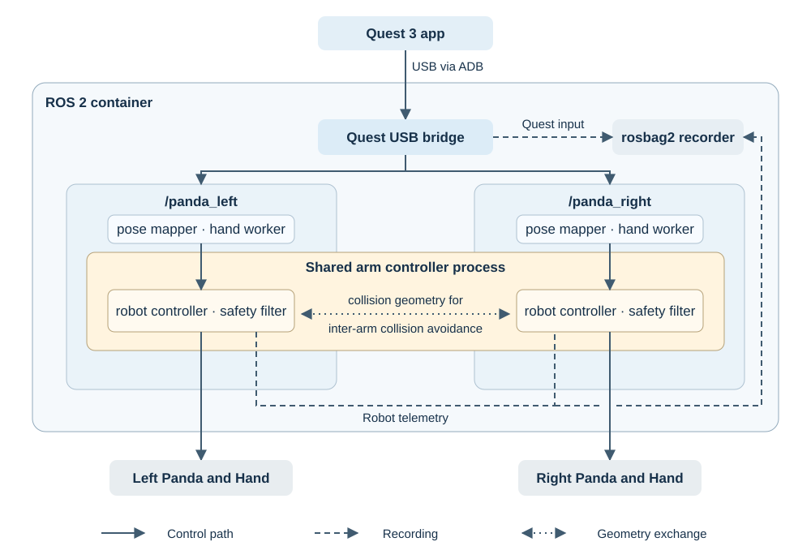
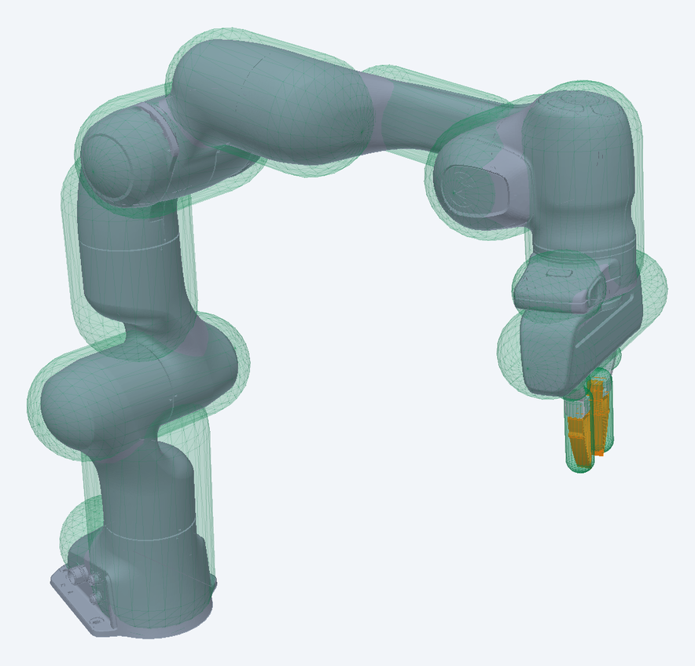

# Franka Panda teleoperation

## 1. Functionality summary

This workspace uses Meta Quest 3 controllers to teleoperate one or two seven-joint Franka Panda arms.

| Package | Functionality |
| --- | --- |
| [Quest Android app and quest_teleop](#2-quest-android-app-and-quest_teleop) | • Acquire controller pose, velocity when available, and button and joystick input. • Transfer samples over USB and align headset and PC timestamps. • Map relative controller motion for Cartesian tracking. • Optionally publish a synthetic robot pose for testing the mapper without a robot. |
| [quest_teleop_interfaces](#3-quest_teleop_interfaces) | • Define customized ROS messages for Quest input, arm commands, robot feedback, and timing. • Define the Hand calibration service.   |
| [teleop_bringup](#4-teleop_bringup) | • Use <code>teleoperation.launch.py</code> for both single-arm and dual-arm teleoperation. • Single arm uses <code>runtime_config:=/ws/src/teleop_bringup/config/single_panda/single_panda.yaml</code>. • Dual arm uses <code>runtime_config:=/ws/src/teleop_bringup/config/dual_panda/dual_panda.yaml</code>. |
| [teleop_controllers](#5-teleop_controllers) | • Track Cartesian position and orientation. • Track Cartesian orientation while holding position. • Hold a captured joint posture. • Return to the configured home posture on request. • Apply actuator limits and publish tracking telemetry. |
| [cbf_safety_filter](#6-cbf_safety_filter) | • Compute and verify candidate torques against enabled joint, table, collision, and singularity constraints. • Check inter-arm clearance in dual-arm operation when enabled. • Support offline replay of filter computations for evaluation. |
| [teleop_gripper](#7-teleop_gripper) | • Calibrate the Hand and use joystick input to open or close it. • Report measured opening width and confirmed grasp state. |
| [recording](#8-recording) | • Record selectable ROS topics continuously after launch or under Quest Menu button control. • Export recorded tracking samples to CSV for offline analysis. |
| [Workspace tooling](#9-workspace-and-external-dependencies) | • Provide Docker environments and pinned dependencies. • Provide tools for visualization, replay, analysis, and diagnostics. |

Figure 1. Both arms run in one ROS 2 container under /panda_left and /panda_right and share the Quest USB bridge and recorder. The controllers can exchange collision geometry within their shared process when inter-arm collision avoidance is enabled. The single-arm profile uses one arm namespace, /panda_1.

## 2. Quest Android app and quest_teleop

### 2.1 Data Acquisition and Reference Frame
The app synchronizes OpenXR actions and obtains each Quest controller’s pose and available twist relative to the headset runtime’s LOCAL coordinate frame. This frame is fixed to the surroundings between recenter events, with $+Y_Q$ pointing up along the gravity-aligned vertical, $+X_Q$ pointing right, and $-Z_Q$ pointing forward.

Each arm uses its own `panda_link0` frame. Its origin is fixed at the robot base, on the first joint’s rotation axis. The $+Z_B$ axis points from the base toward the first joint. The $X_B$ and $Y_B$ axes lie in the base plane and form a right-handed frame with $Z_B$.

The mapper uses a configured rotation $B$ to express Quest LOCAL motion in the robot base frame. The single-arm and dual-arm runtime configurations use the quaternion $(x,y,z,w)=(0.5,0.5,0.5,0.5)$, which gives

$$
B=\begin{bmatrix}0&0&1\\1&0&0\\0&1&0\end{bmatrix}.
$$

Quest right ($+X_Q$) maps to $+Y_B$, Quest up ($+Y_Q$) maps to $+Z_B$, and Quest forward ($-Z_Q$) maps to $-X_B$. For a displacement $\Delta p_Q$ and a relative rotation $\Delta R_Q$ expressed in Quest LOCAL coordinates, the corresponding base frame quantities are

$$
\Delta p_B=B\,\Delta p_Q,\qquad
\Delta R_B=B\,\Delta R_Q\,B^{\mathsf T}.
$$

Section 2.2 shows how the mapper combines these transformed changes with the captured robot pose and the translation and rotation scales.

The app also sends trigger, joystick, button and tracking data with a reference-frame generation, sequence and session ID. An status panel in headset displays tracking and USB state.

### 2.2 Pose and Twist Mapping
Each mapper captures the Quest controller pose relative to quest headset's LOCAL frame and measured robot pose when motion engages. Let matrix $B$ transform Quest pose vectors into the robot base, with anchor poses $(p_0,R_0)$ and $(p_{r0},R_{r0})$. The mapped pose is

$$
p_d=p_{r0}+s_pB(p-p_0),\qquad
R_d=\operatorname{Exp}\!\big(s_R\operatorname{Log}(BRR_0^\mathsf{T}B^\mathsf{T})\big)R_{r0}.
$$

Current configurations set translation scale $s_p=0.75$, rotation scale $s_R=0.33$ and an equal blend between mapped native and pose-derived twists when native data is valid. Pose derivation uses OpenXR location time intervals.

Pose and twist have independent processing chains with bypass, one- or four-pole low-pass filtering, and optional causal septic or quintic interpolation. The current single-arm and dual-arm configurations apply a 5 Hz one-pole low-pass filter to twist on each arm. Pose filtering and interpolation are disabled. The filter type and cutoff frequency can be adjusted in the corresponding quest.yaml file.

Trigger hysteresis uses 0.75 to engage and 0.25 to release. Tracking, timing or session faults require a fresh release and re-engagement of Quest trigger to restore teleoperation. Right B and left Y buttons together with trigger select orientation-only tracking.

### 2.3 USB Transport and Sample Timing

Android Debug Bridge (ADB) carries a two-way TCP connection over USB. The Quest app sends controller samples and clock requests. The PC bridge replies to clock requests and sends recording status so the headset can announce when recording starts or ends.

Each sample carries two timestamps. The OpenXR timestamp is the predicted display time for which the pose was estimated. The mapper uses the interval between these timestamps to estimate velocity from pose changes. The Android monotonic timestamp records when the app began collecting the sample. Let $q_1,q_4$ be the headset’s request send and reply receive times, and $p_2,p_3$ the PC’s request receive and reply send times. The bridge estimates the PC-minus-headset clock offset as

$$
\widehat{\Delta}=\frac{(p_2-q_1)+(p_3-q_4)}{2}.
$$

Adding this offset to each acquisition timestamp puts it on the PC clock so the bridge can check the sample’s age.

The bridge validates incoming messages and their order before publishing controller state to ROS. It marks input invalid on disconnect and uses configured limits on sample age and clock synchronization to reject stale or mistimed input.

| Timing quantity | Value | Meaning |
| --- | --- | --- |
| measured transport latency | 1.27 ms median, 0.83–1.82 ms range | • Estimated time from Quest acquisition to receipt by the robot controller on PC, based on hardware trials. • Physical robot response time is beyond the scope of this measurement. |
| maximum input age | 100 ms | • Rejects samples older than this limit as stale. |
| maximum future timestamp offset | 10 ms | • Rejects samples whose converted timestamp is too far ahead of the PC clock. |
| maximum clock offset uncertainty | 10 ms | • Rejects samples when the estimated clock offset uncertainty exceeds this limit. |
| maximum clock synchronization age | 3 s | • Rejects samples when the clock alignment estimate is older than this limit. |

## 3. quest_teleop_interfaces

| Interface | Contract |
| --- | --- |
| `QuestControllerState` | • Carries each controller’s grip pose, available linear and angular velocity, timestamps, and tracking validity. • Reports trigger and grip values, plus `thumbstick_x` and `thumbstick_y` as `float32` values from −1 to +1. `thumbstick_active` (`bool`) indicates joystick availability. • Includes a list of `QuestButtonState` entries for that controller. |
| `QuestButtonState` | • Reports the button `name` (`string`), whether it is `pressed` (`bool`), and whether the input is `active` (`bool`). • Right controller — A and B. • Left controller — X, Y, and Menu. |
| `CartesianTeleopCommand` | • Carries the target pose (`geometry_msgs/Pose`), desired twist (`geometry_msgs/Twist`), and optional twist requested before filtering in one message. • Reports whether motion is enabled, whether tracking is orientation-only, and whether the physical trigger is released. • Identifies the source sample by session, sequence, and timestamp. |
| `ControllerStatus` | • Reports whether the controller uses the hardware or mock backend, whether motion is enabled, and the reason for its current state. • Reports nominal and commanded joint torque in N·m, with flags for torque magnitude and rate limiting. |
| `HomingStatus` | • Identifies the homing request and reports its phase, elapsed time in seconds, and any failure to stop. • Reports desired joint positions in rad, desired velocities in rad/s, and the maximum measured position error and joint velocity. |
| `TrackingSample` | • Groups requested, reference, and measured Cartesian motion, tracking errors, and joint state from the same control cycle. • Records nominal, commanded, and available measured joint torque in N·m. • Carries control and command timestamps in ns and command age in ms for timing analysis. |
| `GripperStatus` | • Reports the current Hand operation, calibration status, and whether a grasp is confirmed. • Reports current and maximum opening in metres and commanded grasp force in newtons. |
| `GripperWidth` | • Reports the measured total finger opening as `width_m` (`float64`, m). • Timestamps the measurement on the PC monotonic clock using `sample_time_pc_monotonic_ns` (`uint64`, ns). |
| `CalibrateGripper` | • Requires two `bool` confirmations in the request, `empty_hand_confirm` and `operator_confirm`. • Returns `accepted` (`bool`) and a status `message` (`string`). |

## 4. teleop_bringup

**Procedure for Combined Launch**

1. Select `single_panda.yaml` for one arm or `dual_panda.yaml` for two arms.
2. Set the backend to `mock` or `hardware`. For hardware, set the IP address of each selected arm. If the safety filter is enabled on hardware, select `shadow` or `filtered` mode. Both arm owners must use the same filter mode in dual-arm hardware operation.
3. From the sourced ROS 2 workspace container, run `ros2 launch teleop_bringup teleoperation.launch.py` with `runtime_config:=<config-path>`. Replace `<config-path>` with the path to the selected YAML file.
   - Single arm uses `/ws/src/teleop_bringup/config/single_panda/single_panda.yaml`.
   - Dual arm uses `/ws/src/teleop_bringup/config/dual_panda/dual_panda.yaml`.

The combined launch takes only one argument, `runtime_config`. The selected profile specifies the robots, backend, enabled components, package configuration files, and overrides. Package settings live in their respective packages and the configuration references them through `package://` paths. Bringup resolves those paths, applies overrides, and validates the robot, controller, Hand, safety filter, and recording settings before starting the selected components.

When a teleoperation session exits, bringup shuts down the entire launch, including recording. Standalone launches are available to run the bridge, mapper, arm controller, Hand, homing, or recorder independently.

## 5. teleop_controllers

### 5.1 Control-Mode Selection and Execution

**Control-mode selection**

- **Cartesian tracking.** Squeeze the trigger to track position and orientation. Release the trigger to disengage tracking and hold the captured joint posture.
- **Orientation-only tracking.** Hold **B** on the right controller or **Y** on the left while the trigger is engaged. The arm tracks orientation while holding its Cartesian position at mode entry.
- **Homing.** With the trigger released, hold **A** on the right controller or **X** on the left for at least one second, then release the button. The arm moves toward the configured home posture.

**Execution**

Each arm has one controller owner. It selects and evaluates the active torque law in the libfranka control callback on hardware or in a 1 ms loop in mock mode. ROS commands and monitoring data pass through bounded queues and snapshots.

At startup and after a valid trigger release, the owner captures the measured joint positions and gradually increases the stiffness of the joint position controller. Loss of active input disarms tracking. The damping controller handles input loss unless the arm can retain a local position hold. If homing is cancelled, the controller decelerates the arm and lets it settle.

During dual-arm hardware startup, each owner reads fresh robot state while waiting for the robot to confirm that torque control has started. The owners use those readings to publish initial collision geometry before the torque control callbacks begin.

### 5.2 Rigid-Body Model

**Model Computation**

The nominal torque controller and the optional safety filter use the same URDF model to compute the joint-space mass matrix $M$, Coriolis vector $c$, and kinematic frames. On hardware, the measured pose comes from `RobotState`, and its flange-to-tool transform defines the frame of the task Jacobian. For each modeled body $i$, let $m_i$ be its mass, $J_{v,i}$ and $J_{\omega,i}$ its linear and angular Jacobians at the center of mass, and $I_i$ its rotational inertia expressed in the base frame. The model computes

$$
M=\sum_i\left(m_iJ_{v,i}^{\mathsf T}J_{v,i}
+J_{\omega,i}^{\mathsf T}I_iJ_{\omega,i}\right),
\qquad
\ddot q=M^{-1}(u-c),
$$

where $u$ is the commanded torque in the workspace’s gravity compensation convention.

**Modified Parameters**

The configured URDF assigns the Franka Hand link a mass of $0.81\,\mathrm{kg}$ and places its centre of mass $40\,\mathrm{mm}$ along the link’s local $+Z$ axis. Its rotational inertia about the centre of mass has diagonal entries $I_{xx}=I_{yy}=I_{zz}=0.1\,\mathrm{kg\,m^2}$ and zero off-diagonal entries, which differs from the physically consistent intertia of Franka Hand.

**Reason for the Modification**

A torque can be within the actuator limits and still produce a predicted acceleration above the safety filter’s limit. At one recorded robot configuration, increasing joint 7 torque by $1\,\mathrm{N{\cdot}m}$ while keeping the other torques fixed increased the predicted joint 7 acceleration by about $513\,\mathrm{rad/s^2}$ with the native Franka model and $2.64\,\mathrm{rad/s^2}$ with the OSCBF URDF model. With the larger torque-to-acceleration gain, even a small torque adjustment can cross the predicted acceleration limit. The safety filter then has less room to choose a torque that satisfies both the acceleration and actuator limits. The model change reduces that sensitivity and hardware trials prove this change to be beneficial for computing reasonable predicted acceleration under changes of commanded torque.

### 5.3 Nominal Torque Computation

**Cartesian PD Control Law**

Let $e_p=p-p_d$ and let $e_R=\operatorname{Log}(RR_d^{\mathsf T})$ be the translation error and shortest-rotation orientation error, respectively, expressed in the robot base frame. With $e=[e_p^{\mathsf T},e_R^{\mathsf T}]^{\mathsf T}$ as the pose error and $e_v=J\dot q-v_d$ as the twist error, the task wrench and nominal torque are

$$
F_{\mathrm{pd}}=-G(e_v+\Lambda_e e),\qquad
\tau_{\mathrm{pd}}=J^{\mathsf T}F_{\mathrm{pd}}+c+\tau_{\mathrm{ns}}.
$$

The wrench law has proportional gain $K_P=G\Lambda_e$ on pose error and derivative gain $K_D=G$ on twist error. $\tau_{ns}$ represents the nullspace torque. The null-space term attracts joints toward the configured home posture, damps joint velocity, and adds joint-limit repulsion. To keep it from changing the Cartesian task, the controller forms $M=LL^{\mathsf T}$, $A=JL^{-\mathsf T}$ and $P=I-A^+A$, then computes

$$
b=K_{\mathrm{ns}}(q_h-q)-D_{\mathrm{ns}}\dot q+r_{\mathrm{lim}},\qquad
\tau_{\mathrm{ns}}=\gamma\,\operatorname{cap}_{\tau_{\max}}(LPL^{-1}b).
$$

Here $q_h$ is the home posture, $r_{\mathrm{lim}}$ is the joint-limit repulsion vector, $A^+$ is the SVD pseudoinverse, and $\gamma$ ramps the secondary torque from zero to one.

For joint $j$, let $q_j^-$ and $q_j^+$ be its lower and upper position limits. Current configurations use an activation margin $m=0.35\,\mathrm{rad}$ and a gain $k=2.0\,\mathrm{N{\cdot}m}$. With $\operatorname{clip}_{[0,1]}(x)=\min(1,\max(0,x))$, the joint-limit bias before null-space projection is

$$
(r_{\mathrm{lim}})_j =
k\left[
\operatorname{clip}_{[0,1]}\!\left(\frac{q_j^-+m-q_j}{m}\right)^2
-
\operatorname{clip}_{[0,1]}\!\left(\frac{q_j-q_j^++m}{m}\right)^2
\right].
$$

The lower-limit term pushes toward increasing $q_j$, and the upper-limit term pushes toward decreasing $q_j$. Halfway into either margin, the bias magnitude is $k(1/2)^2=0.5\,\mathrm{N{\cdot}m}$.

The decomposition of $M$ with Cholesky factor $L$ and the resulting projection satisfie $AP=0$ for the directions retained by the SVD. These directions are the right singular vectors of $A$ whose singular values exceed the numerical threshold. The projector $P$ removes those components from the correction and treats directions below the threshold as having negligible task effect. Before torque capping, mapping the correction back to joint coordinates gives

$$
JM^{-1}\tau_{\mathrm{ns}}
=\gamma\,JM^{-1}LPL^{-1}b
=\gamma\,APL^{-1}b
\approx 0.
$$

The residual comes from any nonzero singular values treated as zero and from numerical roundoff. If the largest joint torque magnitude exceeds the configured cap, the controller scales the whole vector, preserving its projected direction.

**Inverse Dynamics Control Law**

This law computes task inertia $\Lambda=(JM^{-1}J^{\mathsf T})^{-1}$. It uses translation error $p-p_d$ and the implementation's base-frame sine orientation error $e_R=-\frac12\sum_{i=1}^3 R_i\times R_{d,i}$, where $R_i$ and $R_{d,i}$ are columns of current and desired orientation matrices. Let $e$ combine those pose errors and $e_v=J\dot q-v_d$ be the twist error. For configured diagonal stiffness $K$, Cholesky factor $\Lambda=LL^{\mathsf T}$, and damping ratio $\zeta$, the modal damping matrix is calculated as

$$
L^{-1}KL^{-\mathsf T}=V\operatorname{diag}(\omega_i^2)V^{\mathsf T},\qquad
D=LV\operatorname{diag}(2\zeta\omega_i)V^{\mathsf T}L^{\mathsf T}.
$$

Thus the damping coefficient for mode $i$ is $2\zeta\omega_i$. The task acceleration, wrench and torque are

$$
a_d=\ddot{x}_d-\Lambda^{-1}Ke-\Lambda^{-1}De_v,\qquad
F_{\mathrm{id}}=\Lambda a_d,\qquad
\tau_{\mathrm{id}}=J^{\mathsf T}F_{\mathrm{id}}+c+N_\tau M\ddot q_{\mathrm{ns}},
$$

where $N_\tau=I-J^{\mathsf T}\Lambda JM^{-1}$ and $\ddot q_{\mathrm{ns}}=K_q(q_h-q)-D_q\dot q$ provide dynamically consistent home-posture control. Invalid or ill-conditioned task inertia is rejected.

Both control laws can apply configured force and moment limits to the task wrench; reference shaping and tracking-error protection are independently configurable.

### 5.4 Actuation, Protection and Monitoring
Every nominal torque is limited by both magnitude and change from the previous command; the slew interval uses the callback period capped at 1 ms. Current configuration files scale magnitude and rate limits by 0.35 of the maximum value. In CBF shadow mode, nominal clipped torque is sent to robot while filter results are only recorded. In safety filtered mode, the exact outgoing torque is checked against current constraints before issue.
Solver failure, infeasible QP, verification failure or deadline overrun requests the existing protective response: the owner latches motion protection, bypasses the failed filter, and commands bounded braking followed by a low-speed joint hold. In dual mode the protective request is shared by both arm owners. These failures do not directly terminate the controller process. Invalid model data remains a terminating fault.
Telemetry records requested, nominal, outgoing and measured trajectories. The controller's nominal and outgoing commands `tau_J_d` exclude explicit gravity compensation, while robot's sensor torque `tau_J` includes it, because Franka has a built-in convention that computes gravity-compensation automatically.

## 6. cbf_safety_filter

### 6.1 Constraint Construction and Recovery
This ROS-independent C++ library converts joint, point and task derivatives into affine torque inequalities. For a signed constraint $h\ge0$, a first-order row is $\dot h+\alpha h\ge0$. A second-order row is $\ddot h+(\alpha_1+\alpha_2)\dot h+\alpha_1\alpha_2h\ge0, \quad \psi=\dot h+\alpha_1h.$

The runtime uses synchronous hard constraints with bounded recovery for all enabled constraint families.

When the robot is within the safe region and the requested constraints are compatible, the filter enforces the constructed constraints and computes a torque candidate that satisfies those constraints. The torque candidate can be computed with either `projection` or `native_qp` method.
`Projection` starts from nominal torque clipped to actuator limits, then visits the requested constraints one at a time. For each violated constraint, it applies a weighted correction to reduce the violation. It repeats this sequence up to 6 times and checks whether the result satisfies all requested constraints. If not, it repeats the process with bounded-recovery limits. This method does not prove that the requested constraints are infeasible; it switches to recovery if its bounded projection does not produce a candidate that satisfies them.
`native_qp` first uses analytic_nominal shortcuts when enabled: it accepts the clipped nominal torque if it satisfies every requested constraint, or tries an exact weighted correction for a single violated constraint. If neither yields a valid candidate, the configured QP solver finds the torque closest to nominal while satisfying the requested constraints and actuator limits. If the solver reports infeasibility, the filter repeats the process with bounded-recovery limits. If a valid-model QP result cannot be verified, it falls back to the projection method.

When safety constraints conflict or a state is already outside the safety region, a bounded recovery strategy is implemented as fallback for both safety torque computation methods. The bounded recovery strategy allows limited violations to constraints so that the robot can still brake or avoid making the unsafe condition worse. Recovery first anchors deceleration at $-k_b\dot q$, clips it to configured acceleration limits and maps it to torque within the current actuator box. If requested constraints conflict, the recovery path relaxeds constraint bounds only as needed to include that anchor. 

Final torque acceptance requires independent checks against the recovery rows, actuator box and residual tolerances.

### 6.2 Optimization and Verification
The hard quadratic programming (QP) formulation has seven torque variables and minimizes

$$
\frac{1}{2}(u-u_n)^{\mathsf T}W(u-u_n),
$$

where $u_n$ is nominal torque and $W$ is a positive diagonal weight matrix. All configured constraints remain hard, it currently supports no slack variables or per-constraint-family relaxation policies. An actuator-box candidate or a one-row projection can avoid a native QP solve when it satisfies all rows. Otherwise, the configured qpOASES, OSQP or PIQP solver runs synchronously.
The owner independently verifies outgoing torque against current constraints. Solver tolerances govern convergence; and a separate post-solve acceptance-limit is specified for checking row and actuator-box residuals. Candidates from projection and QP solver are checked against the same acceptance limits.

### 6.3 Constraint Families
Constraint families include joint position, velocity and acceleration, table height, self-collision, dual-arm inter-arm collision and task-Jacobian singularity. Joint-position and velocity margins shrink the permitted range around their configured limits. Joint acceleration is bounded explicitly in joint space. Table clearance is measured against robot origin of the world frame of reference. Collision constraints separate between configured geometry volumes, their radii and clearance. A boundary activation parameter specifies a distance for self-collision and inter-arm collision respectively. When the calculated distance between two collision volumes is lower than the sum of the specified activation distance and clearance, pairwise body collision constraints are then constructed and checked. Singularity uses the squared minimum singular value of the characteristic-length-scaled task Jacobian against a configured threshold.

### 6.4 Collision Geometry
Each dual owner loads 15 sphere or capsule volumes for the base, links, housing and fingers. The right base is offset from the left by $(0,-0.750,0)$ m with identity relative orientation. Table checks omit the collision volumes for base and Link 1. Four finger volumes use width feedback no older than 30 ms with an inflated motion interval; without fresh feedback the model covers the full 0–80 mm opening range. The policy for dual inter-arm collision avoidance is `independent`: each filter checks local geometry against the latest valid peer snapshot, rejecting snapshots over configured age or timestamp-skew limits.

*Figure 2. Collision geometry for one Panda arm: detailed robot and UMI meshes with all collision volumes shown in green.*

### 6.5 Failure Response and Diagnostics
As failure responses, the safety filter require `request_existing_protective_handling` for solver failure, infeasible QP and deadline overrun. At runtime these conditions latch the bounded braking-and-hold response instead of ending the control session. `invalid_model` is configured to terminate control because a trustworthy protective torque cannot be computed from invalid model data. Diagnostics preserve solver status, hard-row residuals, timing, recovery-bound widening and whether a protective command was issued.

## 7. teleop_gripper

### 7.1 Calibration and Command Logic
The Hand worker owns a separate Franka Hand connection and supports a mock backend. Calibration invokes Franka SDK homing only after the service receives both required confirmations.
Moving right-controller joystick horizontally left closes and right opens the gripper; directions are reversed for the left controller. Direction thresholds and hysteresis select configured speeds. Neutral or stale input interrupts an unfinished move, and a fresh neutral sample is required before movement resumes after input loss.

### 7.2 Grasp and Feedback
Closing uses the configured grasp force. A grasp is confirmed only when the Franka SDK reports success, grasp state is present and measured width is within the configured cable interval. Confirmation persists through neutral input or input loss until an explicit opening command. Stop is coordinated with outstanding Hand operations. Gripper width and status are published independently of the arm torque loop.

## 8. recording

Continuous mode starts rosbag2 with the selected topics when the recorder launches with teleoperation bringup combined launch. Menu mode uses validated rising edges from the left Menu button, requires a fresh release after input/session faults, and applies a default 350 ms debounce for avoiding accidental double clicks. A toggle of Menu button starts or stops a separate recorder process.
On normal launch shutdown or arm-owner exit, the recorder asks rosbag2 to stop cleanly with SIGINT signal and waits for it to finish writing the bag. If rosbag2 has not exited after 10 seconds, the recorder sends a stronger stop SIGTERM signal; if it is still running 3 seconds later, the recorder forces it to stop with SIGKILL signal, which may leave the bag incomplete.
SQLite3 is used for data storage. The default topics include Quest input, arm commands and measured/tracking state, Hand events and width, and safety filter status when safety filter is enabled. TrackingSample export produces per-topic CSV files and a manifest with sample counts, queue drops and PC-monotonic time origins.
MATLAB scripts compute tracking error, velocity lag and actuator intervention. PlotJuggler scripts provide live views.

## 9. Workspace and external dependencies

Docker provides ROS 2 Humble in a host-network container with real-time scheduling permissions, alongside separate Android build and MATLAB environments. The environment hook defaults to DDS domain 42 and localhost discovery. Workspace scripts support APK/ADB setup, robot-network profiles and latency tuning, model/geometry generation, benchmark and bag replay, and monitoring.

| Dependency or package | Role |
| --- | --- |
| libfranka 0.9.2 | Arm FCI and Hand API. Local patches allow Hand Stop during an outstanding operation, observe state during arm startup and select fresh queued FCI feedback with a bounded drain. |
| qpOASES, OSQP, PIQP | Active-set, operator-splitting and interior-point QP backend solvers linked or built by the CBF package. |
| franka_description, franka_msgs, franka_semantic_components | Upstream robot descriptions and meshes, message definitions, and ros2_control state/model adapters. |
| franka_hardware, franka_robot_state_broadcaster, franka_control2 | Upstream ros2_control hardware, state broadcasting and control integration. The integrated runtime uses its own direct FCI and Hand owners. |
| franka_bringup, franka_example_controllers, franka_gripper, franka_moveit_config | Upstream launch files, example controllers, gripper node and MoveIt configuration. |
